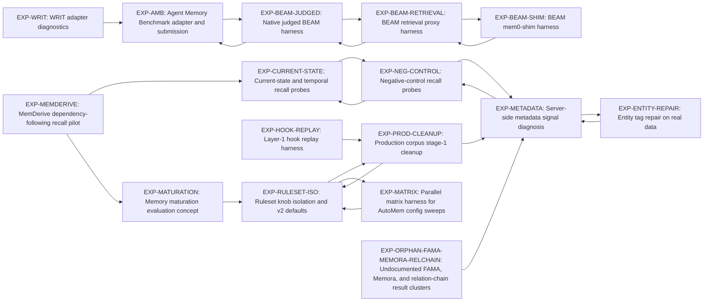

# Experiment Status

Generated: `2026-10-22T06:44:21+00:00`

This file is generated by `python3 scripts/experiment_index.py`.
Edit `docs/experiments/registry.json` instead of hand-editing this dashboard.

## Thread Overview

- `EXP-BEAM-SHIM` **BEAM mem0-shim harness** - `superseded`; The upstream BEAM runner can be pointed at AutoMem through a mem0-compatible shim. Decision: Superseded by EXP-BEAM-RETRIEVAL and EXP-BEAM-JUDGED; keep artifacts for historical comparison. Artifacts: 17. Updated: `2026-04-24`.
- `EXP-ORPHAN-FAMA-MEMORA-RELCHAIN` **Undocumented FAMA, Memora, and relation-chain result clusters** - `parked`; These result clusters likely represent real experiments, but the hypothesis and decision are not recorded in session notes. Decision: Keep parked until someone reviews the raw outputs and either backfills records or deletes the artifacts. Artifacts: 0. Updated: `2026-06-22`.
- `EXP-MATURATION` **Memory maturation evaluation concept** - `parked`; Recall quality may improve through maturation or consolidation processes beyond immediate ingestion. Decision: Parked until a concrete maturation runner is prioritized. Artifacts: 1. Updated: `2026-06-17`.
- `EXP-MEMDERIVE` **MemDerive dependency-following recall pilot** - `in-progress`; Following recorded derivation dependencies can gather intermediate state missed by ordinary recall. Decision: Proceed with dev-world diagnostics; defer server changes and benchmark claims until broader matched-budget and maintenance evidence exists. Artifacts: 1. Updated: `2026-10-22`.
- `EXP-AMB` **Agent Memory Benchmark adapter and submission** - `in-progress`; AutoMem can be evaluated against external AMB datasets by adapting benchmark memory and recall calls into the server's native API. Decision: Keep in progress until the active AMB run finishes, aggregate its outputs, and decide whether to PR the amb-adapter worktree. Artifacts: 0. Updated: `2026-06-22`.
- `EXP-BEAM-JUDGED` **Native judged BEAM harness** - `in-progress`; AutoMem should be measured with BEAM's judged answer task, not only proxy retrieval metrics, to make leaderboard-comparable claims. Decision: Park promotion decisions until the active judged/AMB runs complete and the branch lands. Artifacts: 2. Updated: `2026-06-22`.
- `EXP-MATRIX` **Parallel matrix harness for AutoMem config sweeps** - `adopted`; A matrix runner with isolated stacks can compare many endpoints, rulesets, and scenarios without cross-run contamination. Decision: Adopted as infrastructure; no active worktree remains. Artifacts: 6. Updated: `2026-06-17`.
- `EXP-BEAM-RETRIEVAL` **BEAM retrieval proxy harness** - `adopted`; A deterministic retrieval-only BEAM proxy can provide a cheap signal before running expensive judged BEAM. Decision: Use as a cheap preflight, not as the final benchmark claim. Artifacts: 1. Updated: `2026-06-13`.
- `EXP-METADATA` **Server-side metadata signal diagnosis** - `adopted`; Better metadata treatment can improve /recall behavior on real-data probes without changing vectors. Decision: Adopt metadata A/B and vector identity checks as part of server-side recall diagnostics. Artifacts: 0. Updated: `2026-06-11`.
- `EXP-NEG-CONTROL` **Negative-control recall probes** - `adopted`; Negative controls can expose broad overfetch and unsafe recall wins that positive-only scenarios miss. Decision: Adopt as guardrail coverage for recall regression testing. Artifacts: 1. Updated: `2026-06-11`.
- `EXP-ENTITY-REPAIR` **Entity tag repair on real data** - `adopted`; Canonicalizing entity tags and rejecting unsafe metadata updates can improve recall without broad overfetch. Decision: Adopt staged repair evaluation before metadata migrations. Artifacts: 1. Updated: `2026-06-10`.
- `EXP-CURRENT-STATE` **Current-state and temporal recall probes** - `adopted`; Recall should prefer current facts over stale superseded facts when both exist. Decision: Use as a targeted regression harness for temporal validity. Artifacts: 9. Updated: `2026-05-22`.
- `EXP-WRIT` **WRIT adapter diagnostics** - `adopted`; WRIT-style history-aware adapter diagnostics can complement /recall scenario scoring. Decision: Keep as a supplemental benchmark harness, separate from official AutoMem benchmark claims. Artifacts: 0. Updated: `2026-05-22`.
- `EXP-HOOK-REPLAY` **Layer-1 hook replay harness** - `adopted`; Canned hook fixtures can detect capture-quality regressions before they reach production memory. Decision: Adopt as layer-1 regression coverage for ingestion hooks. Artifacts: 1. Updated: `2026-05-03`.
- `EXP-PROD-CLEANUP` **Production corpus stage-1 cleanup** - `adopted`; Noisy memory clusters can be identified and staged for deletion without damaging preserved recall scenarios. Decision: Adopt staged cleanup workflow for raw corpus pruning. Artifacts: 12. Updated: `2026-05-01`.
- `EXP-RULESET-ISO` **Ruleset knob isolation and v2 defaults** - `adopted`; Isolating recall knobs across the same scenarios can attribute quality changes to specific parameters. Decision: Adopt bare_tag_1m_v2 as the recommended local default; treat server-side expand_relations under tag gating as ineffective. Artifacts: 7. Updated: `2026-04-18`.

## Lineage

## In Progress / Needs Decision

- `EXP-MEMDERIVE`: Proceed with dev-world diagnostics; defer server changes and benchmark claims until broader matched-budget and maintenance evidence exists. (branch: `agent/kernel-worker/328d6b09`, worktree: `n/a`).
- `EXP-AMB`: Keep in progress until the active AMB run finishes, aggregate its outputs, and decide whether to PR the amb-adapter worktree. (branch: `feat/amb-adapter`, worktree: `../automem-evals.worktrees/amb-adapter`).
- `EXP-BEAM-JUDGED`: Park promotion decisions until the active judged/AMB runs complete and the branch lands. (branch: `feat/beam-judged-harness`, worktree: `../automem-evals`).

## Worktree & Branch Reconciliation

- No git worktrees detected or VCS scanning was disabled.

Registry worktree refs that are not currently present:
- `EXP-AMB` expected `../automem-evals.worktrees/amb-adapter` for branch `feat/amb-adapter`.
- `EXP-MATRIX` expected `../automem-evals.worktrees/matrix-harness` for branch `feat/matrix-parallel-harness`.
- `EXP-BEAM-JUDGED` expected `../automem-evals` for branch `feat/beam-judged-harness`.

## Benchmark Scores

- No benchmark score artifacts reachable from the scanned data root. Run with `--data-root` pointing at the checkout that holds the run results.

## Undocumented Runs

- `data/results/20260501-122106-prod-stage1-dry-run.md` - `artifact`; Production Stage 1 Cleanup Dry-Run
- `data/results/20260501-173242-graph-diagnostics.md` - `artifact`; Local AutoMem graph diagnostics - 2026-05-01T17:32:42
- `data/results/SUMMARY-amb-submission-2026-06.md` - `curated-summary`; SUMMARY — AutoMem on the Agent Memory Benchmark (Core-3 + BEAM)
- `docs/eval/atma-ltp.md` - `eval-doc`; A-TMA / LTP — state-aware ghost-memory evaluation
- `docs/session_20260423_failure_modes.md` - `session-note`; Session 2026-04-23 — V1 failure-mode forensics
- `docs/session_20260423_overnight_insights.md` - `session-note`; Session 2026-04-23 — Overnight insights: V1 vs V2 on BEAM 100K
- `docs/session_20260423_overnight_strategy.md` - `session-note`; Session 2026-04-23 — Overnight strategy (apples-to-apples)
