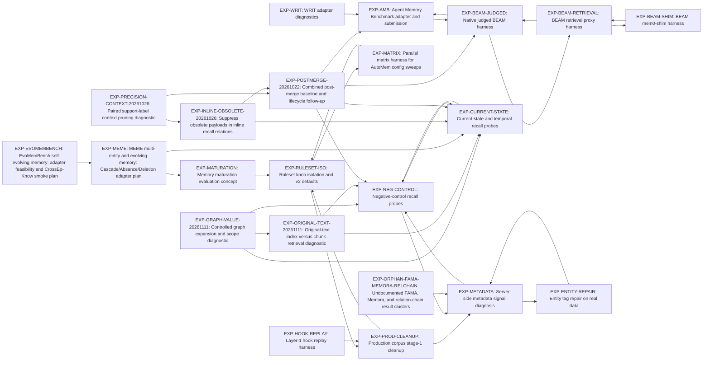

# Experiment Status

Historical AMB snapshot: LoCoMo, PersonaMem, BEAM-100K values retained from the index generated 2026-06-22T20:26:29+00:00 because the raw archives are unavailable. These are historical values, not fresh AMB results. Source: origin/main@35fa73d, docs/experiments/index.json; full source commit/hash recorded per retained row in index.json.

Generated: `2026-11-13T00:24:21+00:00`

Refresh with `python3 data/results/postmerge-20261022/refresh_dashboard.py`.
Edit `docs/experiments/registry.json` instead of hand-editing this dashboard.

## Thread Overview

- `EXP-BEAM-SHIM` **BEAM mem0-shim harness** - `superseded`; The upstream BEAM runner can be pointed at AutoMem through a mem0-compatible shim. Decision: Superseded by EXP-BEAM-RETRIEVAL and EXP-BEAM-JUDGED; keep artifacts for historical comparison. Artifacts: 17. Updated: `2026-04-24`.
- `EXP-AMB` **Agent Memory Benchmark adapter and submission** - `parked`; AutoMem can be evaluated against external AMB datasets by adapting benchmark memory and recall calls into the server's native API. Decision: Defer refresh and scaling work until the post-merge baseline is reconciled and the next retrieval change has a matched result. Artifacts: 1. Updated: `2026-10-22`.
- `EXP-BEAM-JUDGED` **Native judged BEAM harness** - `parked`; AutoMem should be measured with BEAM's judged answer task, not only proxy retrieval metrics, to make leaderboard-comparable claims. Decision: Defer refresh and scaling work until the post-merge baseline is reconciled and the next retrieval change has a matched result. Artifacts: 29. Updated: `2026-10-22`.
- `EXP-ORPHAN-FAMA-MEMORA-RELCHAIN` **Undocumented FAMA, Memora, and relation-chain result clusters** - `parked`; These result clusters likely represent real experiments, but the hypothesis and decision are not recorded in session notes. Decision: Keep parked until someone reviews the raw outputs and either backfills records or deletes the artifacts. Artifacts: 6. Updated: `2026-06-22`.
- `EXP-MATURATION` **Memory maturation evaluation concept** - `parked`; Recall quality may improve through maturation or consolidation processes beyond immediate ingestion. Decision: Parked until a concrete maturation runner is prioritized. Artifacts: 1. Updated: `2026-06-17`.
- `EXP-GRAPH-VALUE-20261111` **Controlled graph expansion and scope diagnostic** - `in-progress`; Graph expansion can improve linked-fact retrieval within a fixed context budget without returning foreign, stale, or excessive evidence. Decision: Complete isolated no-judge mini/full benchmarks and record comparisons; independently review scope and limit PRs. Do not infer agent success or general graph value from the combined synthetic replay. Artifacts: 1. Updated: `2026-11-13`.
- `EXP-EVOMEMBENCH` **EvoMemBench self-evolving memory: adapter feasibility and CrossEp-Know smoke plan** - `in-progress`; A tag-isolated AutoMem recall/store backend can be wired into the EvoMemBench CrossEp-Know driver without editing the unlicensed upstream tree; supersession (t_invalid, INVALIDATED_BY) can only be credited on the separate InEp-Know FactConsolidation suite. Decision: Track in issue #90 at medium-low priority: runners/evomembench/ adapter plus a 17-episode CrossEp-Know wiring smoke on a local AutoMem endpoint after an owner-approved cap and a spend-guard path. No vendoring of upstream code or data. InEp-Know FactConsolidation adapter is a separate follow-up. Artifacts: 1. Updated: `2026-11-10`.
- `EXP-MEME` **MEME multi-entity and evolving memory: Cascade/Absence/Deletion adapter plan** - `in-progress`; Typed AutoMem edges plus t_invalid supersession may deliver the change event or a propagated value in a single retrieval, closing Cascade/Absence/Deletion without Opus-class write-time cost. Decision: Track adapter work in the MEME issue (pending filing); no paid run until the spend guard supports the paper's models or a non-comparable column is chosen, and the owner approves a cap. Publish per-task accuracy with answerer/judge/cost disclosure only after actual AutoMem runs. Artifacts: 1. Updated: `2026-11-04`.
- `EXP-ORIGINAL-TEXT-20261111` **Original-text index versus chunk retrieval diagnostic** - `completed`; A separate native original-text index can recover facts lost during summarization without crossing scope or lifecycle boundaries; chunk vectors may improve evidence coverage. Decision: Use explicit legacy trust only in disposable tests; do not infer agent success or production latency. Investigate calibrated abstention and a matched server chunk arm. Artifacts: 1. Updated: `2026-11-11`.
- `EXP-PRECISION-CONTEXT-20261026` **Paired support-label context pruning diagnostic** - `completed`; Removing off-label retrieved context may improve preference answer correctness while preserving all retrieved labeled support. Decision: Next: blinded evidence-anchored calibration of all 60 saved preference answers; no retrieval change or paid rerun. Graph comparison and broader work remain parked. Artifacts: 6. Updated: `2026-11-02`.
- `EXP-INLINE-OBSOLETE-20261026` **Suppress obsolete payloads in inline recall relations** - `completed`; Current-state recall must apply lifecycle suppression to inline relation payloads as well as top-level results, while retaining edge provenance and explicit history access. Decision: Focused fix and evidence merged in automem#273 / evals#78. Precision diagnostic reconciled in EXP-PRECISION-CONTEXT-20261026; calibrate scoring before a retrieval change. Keep #270 and broader #31 work parked. Artifacts: 4. Updated: `2026-10-26`.
- `EXP-POSTMERGE-20261022` **Combined post-merge baseline and lifecycle follow-up** - `completed`; Merged embedding, lifecycle, enrichment and tag fixes improve write correctness without introducing retrieval regressions; answer-quality impact requires fresh ingestion. Decision: Baseline complete; inline fix/evidence merged. Precision diagnostic retrospectively reviewed; next calibrate preference scoring. Keep graph comparison, #270, AMB/BEAM refresh, new adapters and architecture parked. Artifacts: 5. Updated: `2026-10-26`.
- `EXP-MATRIX` **Parallel matrix harness for AutoMem config sweeps** - `adopted`; A matrix runner with isolated stacks can compare many endpoints, rulesets, and scenarios without cross-run contamination. Decision: Adopted as infrastructure; no active worktree remains. Artifacts: 12. Updated: `2026-06-17`.
- `EXP-BEAM-RETRIEVAL` **BEAM retrieval proxy harness** - `adopted`; A deterministic retrieval-only BEAM proxy can provide a cheap signal before running expensive judged BEAM. Decision: Use as a cheap preflight, not as the final benchmark claim. Artifacts: 4. Updated: `2026-06-13`.
- `EXP-METADATA` **Server-side metadata signal diagnosis** - `adopted`; Better metadata treatment can improve /recall behavior on real-data probes without changing vectors. Decision: Adopt metadata A/B and vector identity checks as part of server-side recall diagnostics. Artifacts: 37. Updated: `2026-06-11`.
- `EXP-NEG-CONTROL` **Negative-control recall probes** - `adopted`; Negative controls can expose broad overfetch and unsafe recall wins that positive-only scenarios miss. Decision: Adopt as guardrail coverage for recall regression testing. Artifacts: 1. Updated: `2026-06-11`.
- `EXP-ENTITY-REPAIR` **Entity tag repair on real data** - `adopted`; Canonicalizing entity tags and rejecting unsafe metadata updates can improve recall without broad overfetch. Decision: Adopt staged repair evaluation before metadata migrations. Artifacts: 21. Updated: `2026-06-10`.
- `EXP-CURRENT-STATE` **Current-state and temporal recall probes** - `adopted`; Recall should prefer current facts over stale superseded facts when both exist. Decision: Use as a targeted regression harness for temporal validity. Artifacts: 18. Updated: `2026-05-22`.
- `EXP-WRIT` **WRIT adapter diagnostics** - `adopted`; WRIT-style history-aware adapter diagnostics can complement /recall scenario scoring. Decision: Keep as a supplemental benchmark harness, separate from official AutoMem benchmark claims. Artifacts: 42. Updated: `2026-05-22`.
- `EXP-HOOK-REPLAY` **Layer-1 hook replay harness** - `adopted`; Canned hook fixtures can detect capture-quality regressions before they reach production memory. Decision: Adopt as layer-1 regression coverage for ingestion hooks. Artifacts: 1. Updated: `2026-05-03`.
- `EXP-PROD-CLEANUP` **Production corpus stage-1 cleanup** - `adopted`; Noisy memory clusters can be identified and staged for deletion without damaging preserved recall scenarios. Decision: Adopt staged cleanup workflow for raw corpus pruning. Artifacts: 56. Updated: `2026-05-01`.
- `EXP-RULESET-ISO` **Ruleset knob isolation and v2 defaults** - `adopted`; Isolating recall knobs across the same scenarios can attribute quality changes to specific parameters. Decision: Adopt bare_tag_1m_v2 as the recommended local default; treat server-side expand_relations under tag gating as ineffective. Artifacts: 30. Updated: `2026-04-18`.

## Lineage

## In Progress / Needs Decision

- `EXP-GRAPH-VALUE-20261111`: Complete isolated no-judge mini/full benchmarks and record comparisons; independently review scope and limit PRs. Do not infer agent success or general graph value from the combined synthetic replay. (branch: `test/graph-value-probe`, worktree: `../automem-evals.worktrees/graph-value-probe`).
- `EXP-EVOMEMBENCH`: Track in issue #90 at medium-low priority: runners/evomembench/ adapter plus a 17-episode CrossEp-Know wiring smoke on a local AutoMem endpoint after an owner-approved cap and a spend-guard path. No vendoring of upstream code or data. InEp-Know FactConsolidation adapter is a separate follow-up. (branch: `agent/kernel-worker/c49de4c4`, worktree: `.worktrees/agent-kernel-worker-c49de4c4`).
- `EXP-MEME`: Track adapter work in the MEME issue (pending filing); no paid run until the spend guard supports the paper's models or a non-comparable column is chosen, and the owner approves a cap. Publish per-task accuracy with answerer/judge/cost disclosure only after actual AutoMem runs. (branch: `agent/kernel-worker/4a5dd6bc`, worktree: `.worktrees/agent-kernel-worker-4a5dd6bc`).

## Worktree & Branch Reconciliation

- `main` at `/Users/jgarturo/Projects/OpenAI/automem-evals` - `primary`; no PR; dirty entries: `1`; keep/review.
- `docs/postmerge-baseline-index` at `/Users/jgarturo/.codex/worktrees/postmerge-baseline/automem-evals` - `merged`; PR #73 `MERGED`; dirty entries: `1`; cleanup candidate.
- `test/paid-baseline-budget` at `/Users/jgarturo/.codex/worktrees/postmerge-budget-review/automem-evals` - `merged`; PR #71 `MERGED`; dirty entries: `0`; cleanup candidate.
- `feat/amb-adapter` at `/Users/jgarturo/Projects/OpenAI/automem-evals.worktrees/amb-adapter` - `in-flight`; no PR; dirty entries: `7`; keep/review.
- `feat/aml-cycle2-adapter` at `/Users/jgarturo/Projects/OpenAI/automem-evals.worktrees/aml-cycle2-adapter` - `open-pr`; PR #29 `OPEN`; dirty entries: `0`; keep/review.
- `feat/experiment-registry` at `/Users/jgarturo/Projects/OpenAI/automem-evals.worktrees/experiment-registry` - `merged`; PR #20 `MERGED`; dirty entries: `0`; cleanup candidate.
- `test/inline-obsolete-baseline` at `/Users/jgarturo/Projects/OpenAI/automem-evals.worktrees/inline-obsolete-baseline` - `merged`; PR #78 `MERGED`; dirty entries: `0`; cleanup candidate.
- `feat/mem2actbench-pilot` at `/Users/jgarturo/Projects/OpenAI/automem-evals.worktrees/mem2actbench-pilot` - `open-pr`; PR #34 `OPEN`; dirty entries: `0`; keep/review.
- `feat/memorycd-adapter` at `/Users/jgarturo/Projects/OpenAI/automem-evals.worktrees/memorycd-adapter` - `open-pr`; PR #35 `OPEN`; dirty entries: `0`; keep/review.
- `feat/memorycd-automem-adapter` at `/Users/jgarturo/Projects/OpenAI/automem-evals.worktrees/memorycd-automem-adapter` - `in-flight`; no PR; dirty entries: `0`; keep/review.
- `test/precision-context-ablation` at `/Users/jgarturo/Projects/OpenAI/automem-evals.worktrees/precision-context-ablation` - `open-pr`; PR #82 `OPEN`; dirty entries: `18`; keep/review.
- `agent/kernel-worker/01f6c283` at `/Users/jgarturo/Projects/OpenAI/automem-evals/.worktrees/agent-kernel-worker-01f6c283` - `open-pr`; PR #80 `OPEN`; dirty entries: `0`; keep/review.
- `agent/kernel-worker/082439ff` at `/Users/jgarturo/Projects/OpenAI/automem-evals/.worktrees/agent-kernel-worker-082439ff` - `in-flight`; no PR; dirty entries: `0`; keep/review.
- `agent/kernel-worker/2fa9b7a0` at `/Users/jgarturo/Projects/OpenAI/automem-evals/.worktrees/agent-kernel-worker-2fa9b7a0` - `in-flight`; no PR; dirty entries: `0`; keep/review.
- `agent/kernel-worker/328d6b09` at `/Users/jgarturo/Projects/OpenAI/automem-evals/.worktrees/agent-kernel-worker-328d6b09` - `open-pr`; PR #70 `OPEN`; dirty entries: `0`; keep/review.
- `agent/kernel-worker/33c1eade` at `/Users/jgarturo/Projects/OpenAI/automem-evals/.worktrees/agent-kernel-worker-33c1eade` - `in-flight`; PR #40 `CLOSED`; dirty entries: `0`; keep/review.
- `agent/kernel-worker/34f6a055` at `/Users/jgarturo/Projects/OpenAI/automem-evals/.worktrees/agent-kernel-worker-34f6a055` - `open-pr`; PR #75 `OPEN`; dirty entries: `0`; keep/review.
- `agent/kernel-worker/36a58aae` at `/Users/jgarturo/Projects/OpenAI/automem-evals/.worktrees/agent-kernel-worker-36a58aae` - `open-pr`; PR #56 `OPEN`; dirty entries: `0`; keep/review.
- `agent/kernel-worker/48e22593` at `/Users/jgarturo/Projects/OpenAI/automem-evals/.worktrees/agent-kernel-worker-48e22593` - `open-pr`; PR #68 `OPEN`; dirty entries: `0`; keep/review.
- `agent/kernel-worker/4edda3e0` at `/Users/jgarturo/Projects/OpenAI/automem-evals/.worktrees/agent-kernel-worker-4edda3e0` - `merged`; PR #42 `MERGED`; dirty entries: `0`; cleanup candidate.
- `agent/kernel-worker/53c29f42` at `/Users/jgarturo/Projects/OpenAI/automem-evals/.worktrees/agent-kernel-worker-53c29f42` - `open-pr`; PR #79 `OPEN`; dirty entries: `0`; keep/review.
- `agent/kernel-worker/5d7d2e96` at `/Users/jgarturo/Projects/OpenAI/automem-evals/.worktrees/agent-kernel-worker-5d7d2e96` - `open-pr`; PR #55 `OPEN`; dirty entries: `0`; keep/review.
- `agent/kernel-worker/5d85ec21` at `/Users/jgarturo/Projects/OpenAI/automem-evals/.worktrees/agent-kernel-worker-5d85ec21` - `in-flight`; PR #41 `CLOSED`; dirty entries: `0`; keep/review.
- `agent/kernel-worker/5e36f253` at `/Users/jgarturo/Projects/OpenAI/automem-evals/.worktrees/agent-kernel-worker-5e36f253` - `in-flight`; no PR; dirty entries: `0`; keep/review.
- `agent/kernel-worker/66975d0c` at `/Users/jgarturo/Projects/OpenAI/automem-evals/.worktrees/agent-kernel-worker-66975d0c` - `open-pr`; PR #59 `OPEN`; dirty entries: `0`; keep/review.
- `agent/kernel-worker/6937fb10` at `/Users/jgarturo/Projects/OpenAI/automem-evals/.worktrees/agent-kernel-worker-6937fb10` - `in-flight`; no PR; dirty entries: `0`; keep/review.
- `agent/kernel-worker/6f5d2e77` at `/Users/jgarturo/Projects/OpenAI/automem-evals/.worktrees/agent-kernel-worker-6f5d2e77` - `open-pr`; PR #81 `OPEN`; dirty entries: `0`; keep/review.
- `agent/kernel-worker/7271d230` at `/Users/jgarturo/Projects/OpenAI/automem-evals/.worktrees/agent-kernel-worker-7271d230` - `in-flight`; no PR; dirty entries: `0`; keep/review.
- `agent/kernel-worker/7b268a6f` at `/Users/jgarturo/Projects/OpenAI/automem-evals/.worktrees/agent-kernel-worker-7b268a6f` - `open-pr`; PR #77 `OPEN`; dirty entries: `0`; keep/review.
- `agent/kernel-worker/8329d251` at `/Users/jgarturo/Projects/OpenAI/automem-evals/.worktrees/agent-kernel-worker-8329d251` - `in-flight`; no PR; dirty entries: `0`; keep/review.
- `agent/kernel-worker/92ebad9f` at `/Users/jgarturo/Projects/OpenAI/automem-evals/.worktrees/agent-kernel-worker-92ebad9f` - `open-pr`; PR #66 `OPEN`; dirty entries: `0`; keep/review.
- `agent/kernel-worker/9398bea5` at `/Users/jgarturo/Projects/OpenAI/automem-evals/.worktrees/agent-kernel-worker-9398bea5` - `in-flight`; PR #36 `CLOSED`; dirty entries: `0`; keep/review.
- `agent/kernel-worker/9c74a3e8` at `/Users/jgarturo/Projects/OpenAI/automem-evals/.worktrees/agent-kernel-worker-9c74a3e8` - `open-pr`; PR #69 `OPEN`; dirty entries: `0`; keep/review.
- `agent/kernel-worker/a5b095e4` at `/Users/jgarturo/Projects/OpenAI/automem-evals/.worktrees/agent-kernel-worker-a5b095e4` - `open-pr`; PR #60 `OPEN`; dirty entries: `0`; keep/review.
- `agent/kernel-worker/a5ddec0a` at `/Users/jgarturo/Projects/OpenAI/automem-evals/.worktrees/agent-kernel-worker-a5ddec0a` - `merged`; PR #58 `MERGED`; dirty entries: `0`; cleanup candidate.
- `agent/kernel-worker/b05bc304` at `/Users/jgarturo/Projects/OpenAI/automem-evals/.worktrees/agent-kernel-worker-b05bc304` - `open-pr`; PR #61 `OPEN`; dirty entries: `0`; keep/review.
- `agent/kernel-worker/b8927603` at `/Users/jgarturo/Projects/OpenAI/automem-evals/.worktrees/agent-kernel-worker-b8927603` - `in-flight`; no PR; dirty entries: `0`; keep/review.
- `agent/kernel-worker/b8eb5888` at `/Users/jgarturo/Projects/OpenAI/automem-evals/.worktrees/agent-kernel-worker-b8eb5888` - `in-flight`; no PR; dirty entries: `0`; keep/review.
- `agent/kernel-worker/cf3bbbef` at `/Users/jgarturo/Projects/OpenAI/automem-evals/.worktrees/agent-kernel-worker-cf3bbbef` - `open-pr`; PR #52 `OPEN`; dirty entries: `0`; keep/review.
- `agent/kernel-worker/d228f052` at `/Users/jgarturo/Projects/OpenAI/automem-evals/.worktrees/agent-kernel-worker-d228f052` - `in-flight`; PR #37 `CLOSED`; dirty entries: `0`; keep/review.
- `agent/kernel-worker/da882528` at `/Users/jgarturo/Projects/OpenAI/automem-evals/.worktrees/agent-kernel-worker-da882528` - `open-pr`; PR #63 `OPEN`; dirty entries: `0`; keep/review.
- `agent/kernel-worker/f5dc6287` at `/Users/jgarturo/Projects/OpenAI/automem-evals/.worktrees/agent-kernel-worker-f5dc6287` - `open-pr`; PR #49 `OPEN`; dirty entries: `0`; keep/review.
- `feat/memora-fama-eval` at `/Users/jgarturo/Projects/OpenAI/automem-evals/.worktrees/memora-fama-eval` - `in-flight`; no PR; dirty entries: `2`; keep/review.

Registry worktree refs that are not currently present:
- `EXP-MATRIX` expected `../automem-evals.worktrees/matrix-harness` for branch `feat/matrix-parallel-harness`.

## Benchmark Scores

Full interactive view: `docs/experiments/scoreboard.html` (open in a browser).

- `amb` BEAM-100K: `67.4% (spread 1.6pp, ×3/3)` (n=1120, recall 230 ms, 3843 tok).
- `amb` BEAM-10M: pending (`missing`, n=0).
- `amb` BEAM-1M: pending (`missing`, n=0).
- `amb` BEAM-500K: pending (`missing`, n=0).
- `amb` LoCoMo: `85.1% ± 1.8` (n=1540, recall 132 ms, 4768 tok).
- `amb` LongMemEval: pending (`missing`, n=0).
- `amb` PersonaMem: `76.1% ± 3.4` (n=589, recall 202 ms, 2588 tok).
- `beam-judged` 100K answerer `gpt-5`: latest `70.25%` (run `20260616-042452-1d46f08a`, 400 q).
- `beam-judged` 100K answerer `gpt-5-mini`: latest `0.0%` (run `20260617-121558-6099fa33`, 2 q).
- `beam-judged` 1M answerer `gpt-5-mini`: latest `70.0%` (run `20260616-221846-26f5f74b`, 20 q).

## Undocumented Runs

- `data/results/20260501-122106-prod-stage1-dry-run.md` - `artifact`; Production Stage 1 Cleanup Dry-Run
- `data/results/20260501-173242-graph-diagnostics.md` - `artifact`; Local AutoMem graph diagnostics - 2026-05-01T17:32:42
- `data/sweep_runs/20260501-062019-mirror8011-cleanup/dry2-sweep-memory-cache/summary.json` - `summary-json`; summary-json
- `data/sweep_runs/20260501-062019-mirror8011-cleanup/dry2-sweep-session-milestone/summary.json` - `summary-json`; summary-json
- `data/sweep_runs/20260501-062019-mirror8011-cleanup/exec-sweep-memory-cache/summary.json` - `summary-json`; summary-json
- `data/sweep_runs/20260501-093734-recall-compare-localhost-8011-vs-localhost-8011/summary.json` - `summary-json`; summary-json
- `data/sweep_runs/20260501-093827-recall-compare-localhost-8011-vs-localhost-8011/summary.json` - `summary-json`; summary-json
- `data/sweep_runs/20260501-173242-graph-diagnostics/summary.json` - `summary-json`; summary-json
- `data/sweep_runs/20260501-local-dry-memory-cache/summary.json` - `summary-json`; summary-json
- `data/sweep_runs/20260501-local-dry-session-milestone/summary.json` - `summary-json`; summary-json
- `data/sweep_runs/20260501-local-exec-memory-cache/summary.json` - `summary-json`; summary-json
- `data/sweep_runs/20260606-162441/summary.json` - `summary-json`; summary-json
- `data/sweep_runs/20260606-162501/summary.json` - `summary-json`; summary-json
- `data/sweep_runs/20260606-162514/summary.json` - `summary-json`; summary-json
- `data/sweep_runs/20260606-165450/summary.json` - `summary-json`; summary-json
- `data/sweep_runs/20260606-170328/summary.json` - `summary-json`; summary-json
- `data/sweep_runs/20260606-170942/summary.json` - `summary-json`; summary-json
- `data/sweep_runs/20260606-173839/summary.json` - `summary-json`; summary-json
- `data/sweep_runs/20260606-175951/summary.json` - `summary-json`; summary-json
- `data/sweep_runs/20260609-entity-repair-diagnostics-refresh-post-migration/recall-compare-post-migration/summary.json` - `summary-json`; summary-json
- `data/sweep_runs/20260609-entity-repair-local-loop-v7-sync-only/recall-compare-retry/summary.json` - `summary-json`; summary-json
- `data/sweep_runs/20260609-entity-repair-local-loop-v8-reject-only/recall-compare/summary.json` - `recall-endpoint-comparison`; recall-endpoint-comparison
- `data/sweep_runs/20260609-entity-repair-skip-restore-after-qdrant-retrieve-retry-sync-only/recall-compare/summary.json` - `recall-endpoint-comparison`; recall-endpoint-comparison
- `data/sweep_runs/20260609-entity-repair-strict-after-api-restart/recall-compare-post-migration/summary.json` - `summary-json`; summary-json
- `data/sweep_runs/20260609-entity-repair-strict-after-baseline-qdrant-sync/recall-compare-post-migration/summary.json` - `summary-json`; summary-json
- `data/sweep_runs/20260609-entity-repair-strict-after-score-change/recall-compare-post-migration/summary.json` - `summary-json`; summary-json
- `data/sweep_runs/20260609-entity-repair-strict-gate-check/recall-compare-post-migration/summary.json` - `summary-json`; summary-json
- `data/sweep_runs/20260611-211703-recall-compare-localhost-8121-vs-localhost-8122/summary.json` - `summary-json`; summary-json
- `data/sweep_runs/20260611-212035-recall-compare-localhost-8121-vs-localhost-8122/summary.json` - `summary-json`; summary-json
- `data/sweep_runs/entity-repair-20260606/recall-compare/summary.json` - `recall-endpoint-comparison`; recall-endpoint-comparison
- `data/sweep_runs/prod-rollout-20260610/canonicalize-v1/summary.json` - `summary-json`; summary-json
- `data/sweep_runs/prod-rollout-20260610/canonicalize-v2-executed/summary.json` - `summary-json`; summary-json
- `data/sweep_runs/prod-rollout-20260610/probes-post-repair/summary.json` - `summary-json`; summary-json
- `data/sweep_runs/prod-rollout-20260610/probes-pre-repair/summary.json` - `summary-json`; summary-json
- `data/sweep_runs/prod-rollout-20260610/reject-only-v3/summary.json` - `summary-json`; summary-json
- `data/sweep_runs/prod-rollout-20260610/reject-only-v4-executed/summary.json` - `summary-json`; summary-json
- `data/sweep_runs/prod-rollout-rehearsal-20260610-canonicalize-safe/recall-compare/summary.json` - `recall-endpoint-comparison`; recall-endpoint-comparison
- `data/sweep_runs/prod-rollout-rehearsal-20260610-post-migration/recall-compare/summary.json` - `recall-endpoint-comparison`; recall-endpoint-comparison
- `data/sweep_runs/prod-rollout-rehearsal-20260610-post-migration/recall-compare-post-migration/summary.json` - `summary-json`; summary-json
- `data/sweep_runs/prod-rollout-rehearsal-20260610-reject-only/recall-compare/summary.json` - `recall-endpoint-comparison`; recall-endpoint-comparison
- `data/sweep_runs/prod-rollout-rehearsal-20260610-sync-only/recall-compare/summary.json` - `recall-endpoint-comparison`; recall-endpoint-comparison
- `docs/session_20260423_failure_modes.md` - `session-note`; Session 2026-04-23 — V1 failure-mode forensics
- `docs/session_20260423_overnight_insights.md` - `session-note`; Session 2026-04-23 — Overnight insights: V1 vs V2 on BEAM 100K
- `docs/session_20260423_overnight_strategy.md` - `session-note`; Session 2026-04-23 — Overnight strategy (apples-to-apples)
- `docs/eval/atma-ltp.md` - `eval-doc`; A-TMA / LTP — state-aware ghost-memory evaluation
- `docs/eval/paid-budget.md` - `eval-doc`; Capped benchmark API calls
